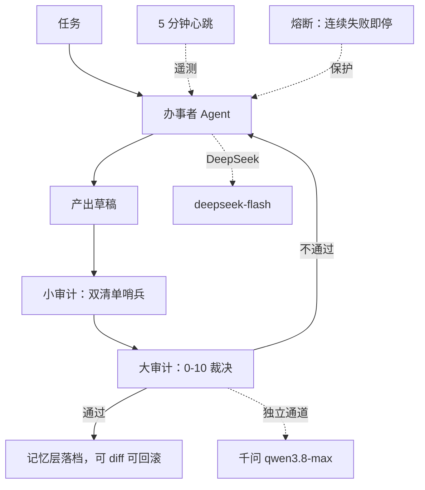

# 项目架构与证据边界（公开版）

> 本页只定义项目级目标架构、证据口径和诚实边界。可执行原语与通用审计环以
> [weft/docs/architecture.md](https://github.com/weft-audit/weft/blob/main/docs/architecture.md)
> 为权威源，本页不复制其接口细节。

## 系统理念（2026-10-19 定稿）

1. 陪伴成长：记忆与审计让系统越用越强——记忆三层落盘，审计闭环纠偏，
   人强则系统强，系统强则反哺人。
2. 随时可移植：核心资产全部纯文本，平台无关；已实证在
   **3 小时 10 分钟**内把治理层六件套迁入另一运行时。
3. 绝对可控：每步可回滚、每条结论挂证据、越权必被拦。2026-10-21 已跑通
   一次经所有者确认的单入口只读任务，但尚未宣称任意复杂任务闭环。

## 审计环

## 四层记忆

## 防自噬

医者不能自医：程序不许修改自己，要修只能由别的程序来修；
能力扩展走插件（Skill 经测试后挂载）。

## 诚实标注

- 图中"心跳"机制在册、当前按拍板暂停。
- 对话者与多 Agent 仍保持主体和上下文隔离；2026-10-21 完成的是
  “显式确认后由自然语言入口触发工作链”的桥，不是两个主体合并。
- 单入口实跑证据只覆盖一条简单只读任务，写操作、长任务、并发和故障恢复
  尚未纳入同一组证据。
