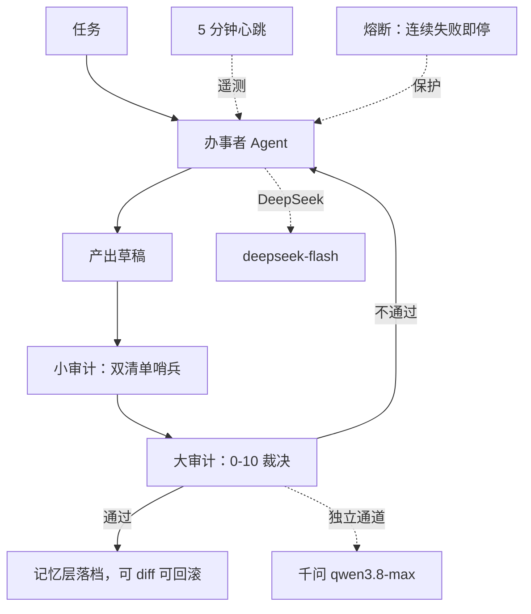

# 架构（公开版）

## 系统理念（2026-10-19 定稿）

1. 陪伴成长：记忆与审计让系统越用越强——记忆三层落盘，审计闭环纠偏，
   人强则系统强，系统强则反哺人。
2. 随时可移植：核心资产全部纯文本，平台无关；已实证一夜整体迁入另一运行时。
3. 绝对可控：每步可回滚、每条结论挂证据、越权必被拦——守门人机制为下一步
   方向，未完成前不宣称闭环。

## 审计环

## 四层记忆

## 防自噬

医者不能自医：程序不许修改自己，要修只能由别的程序来修；
能力扩展走插件（Skill 经测试后挂载）。

## 诚实标注

- 图中"心跳"机制在册、当前按拍板暂停。
- "合一"（对话者与多 Agent 合并）是下一阶段方向，两集团当前物理隔离。
